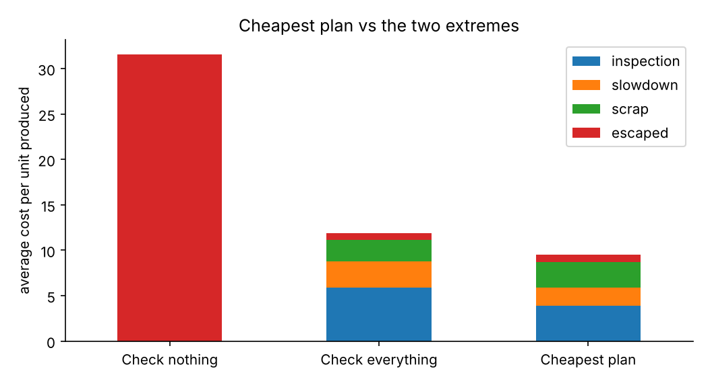

# How Much Inspection Is Enough? A Cost-of-Quality Simulator for Advanced Packaging

A teaching example that shows how a manufacturer of advanced packages (stacked memory such as HBM, or multi-chiplet packages) can compare in-line inspection plans by cost. It adds up checking costs and failure costs, simulates production by chance, and finds the cheapest plan.

> **Illustrative only.** Every number in this repository is made up. It demonstrates a method. It is not tied to any company, product or process, uses no confidential data, and is not advice for real decisions.

## Project summary

The questions this project works through, in plain language:

1. **What does an inspection plan cost?** Add up checking, slowdown, scrapped units and defects that reach customers.
2. **Can we trust the simulation?** Compare it with an exact calculation (built-in self-check).
3. **Which plan is cheapest?** Compare 125 plans on the same virtual units.
4. **What if our assumptions are wrong?** Show which inputs matter most and when the best plan flips.



## Data source

None needed. All inputs are illustrative placeholders defined in `src/cost_model.py`. Replace them with your own estimates to explore your own situation.

## Repository structure

```
packaging-quality-cost-simulator/
├── README.md
├── CHANGELOG.md
├── CONTRIBUTING.md
├── LICENSE
├── requirements.txt
├── docs/
│   ├── concepts.md          # the ideas in plain language
│   ├── glossary.md          # terms explained
│   ├── figures/             # charts used in this README
│   └── run_exports/         # HTML copies made by notebook 00
├── notebooks/
│   ├── 00_run_all.ipynb                      # runs 01-04 and exports HTML
│   ├── 01_the_problem_and_cost_model.ipynb   # the decision and the cost parts
│   ├── 02_simulating_production.ipynb        # random simulation vs exact answer
│   ├── 03_finding_the_cheapest_plan.ipynb    # rank 125 plans
│   └── 04_what_if_assumptions_change.ipynb   # break-even and sensitivity
├── src/
│   ├── cost_model.py        # inputs, cost parts, exact calculation
│   ├── simulate.py          # random simulation
│   ├── search.py            # try every plan, rank them
│   └── sensitivity.py       # what-if analysis
└── tests/
    └── test_checks.py       # simulation must agree with the exact calculation
```

## Setup

```bash
python -m venv .venv
source .venv/bin/activate        # Windows: .venv\Scripts\activate
pip install -r requirements.txt
pytest                            # runs the self-checks
jupyter notebook notebooks/
```

## Working in Google Colab (recommended if you're not set up locally)

GitHub displays notebooks but does not run them.

1. Open Colab, choose **File > Open notebook > GitHub**, and paste this repository's URL.
2. In a first cell run: `!git clone https://github.com/WJPsystems/packaging-quality-cost-simulator.git` and then `%cd packaging-quality-cost-simulator` (edit the URL if you forked or renamed the repository).
3. Run `!pip install -r requirements.txt`.
4. Open any notebook from the `notebooks/` folder and run it.

### Running everything at once

Open `notebooks/00_run_all.ipynb` and run it. It executes notebooks 01 to 04, saves the results into them, and writes an HTML copy of each to `docs/run_exports/`.

## Status

- [x] Cost model with four cost components
- [x] Random simulation and exact self-check (tests pass)
- [x] Search over 125 plans
- [x] What-if analysis (break-even and one-at-a-time sensitivity)
- [x] Notebooks 01 to 04 with saved outputs
- [ ] Richer process options (more steps, rework loops)
- [ ] Additional plan-search methods

Known simplifications are listed in `docs/concepts.md`.

## Versioning

Delivered files follow `<name>_vN_YYYY-MM-DD.<ext>`. Files inside the repository carry no version suffix, because that would break imports. Instead, each notebook shows its version in its first cell, and `CHANGELOG.md` summarizes changes.

## License

Permission-required, source-available. You may view and run the code for personal, non-commercial learning. Any other use needs the author's written permission, and permitted use must credit the author. See `LICENSE`. This is a plain-language custom license that has not been reviewed by a lawyer.

## About

Created by W. J. Philippe (WJPsystems) as an independent educational project. Questions and ideas are welcome through Issues; see `CONTRIBUTING.md`.
